<p align="center">
  <h1 align="center">🛰️ High-Resolution Image Segmentation</h1>
  <p align="center">
    <strong>Semantic Segmentation of Ultra-High-Resolution Imagery using Residual U-Net with Dilated Bottleneck</strong>
  </p>
</p>

<p align="center">
  
  
  
  
</p>

<p align="center">
  
  
  
  
</p>

---

## 📋 Overview

An end-to-end deep learning pipeline for **pixel-wise semantic segmentation** of ultra-high-resolution images
(6000×6000 pixels). Large tiles are cut into patches, segmented by a **Residual U-Net** with a **multi-rate dilated
convolution bottleneck**, and stitched back to a full-resolution map, with optional **8× test-time augmentation**.

> **💡 Why this matters**: this is the core engineering problem of **Digital Pathology** as well as **Remote Sensing** —
> segmenting images that are orders of magnitude larger than a network's input. The same tiling, stitching and TTA used
> here for 6000×6000 aerial tiles applies to **50,000×50,000+ whole-slide histopathology images**
> (see the companion project **VAE-Triage**, which decides *which* WSI tiles are worth segmenting).

📑 **Technical report:** [`report/Technical_Report.pdf`](report/Technical_Report.pdf) · [`report/REPORT.md`](report/REPORT.md) ·
🎤 **Slides:** [`report/Interview_Slides.pptx`](report/Interview_Slides.pptx)

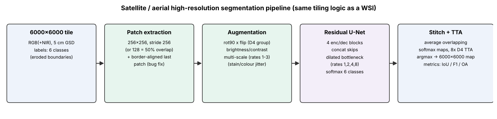

### Key technical components

| Feature | Description |
|---------|-------------|
| 🏗️ **U-Net with dense skips** | Encoder–decoder with skip connections; each block *concatenates* its input and output (DenseNet-style; called "residual" in the code) |
| 🔬 **Multi-rate dilated bottleneck** | Serial/parallel dilated convolutions (rates 1, 2, 4, 8) for multi-scale context (ASPP-like) |
| 🧩 **Patch extraction & stitching** | `tf.image.extract_patches` for training patches; overlap-averaged softmax stitching at inference (now covers the tile border) |
| 🔄 **Test-Time Augmentation** | 8-fold TTA (4 rotations × 2 flips = the D4 group) |
| 📊 **Training strategies** | Learning-Rate Finder + One-Cycle Policy |
| 🎯 **Losses** | Jaccard distance, categorical focal loss for class imbalance |
| 🚀 **tf.data pipeline** | On-the-fly multi-scale patch extraction and augmentation |

---

## 🏛️ Architecture

```
                         Input (256×256×3)
                              │
                    ┌─────────┴─────────┐
                    │    ENCODER PATH    │
                    ├───────────────────┤
                    │  Conv Block (32)   │──── Skip Connection ────┐
                    │  + concat skip     │                         │
                    │  MaxPool 2×2       │                         │
                    ├───────────────────┤                         │
                    │  Conv Block (64)   │──── Skip Connection ──┐ │
                    │  MaxPool 2×2       │                       │ │
                    ├───────────────────┤                       │ │
                    │  Conv Block (128)  │──── Skip Connection ┐ │ │
                    │  MaxPool 2×2       │                     │ │ │
                    ├───────────────────┤                     │ │ │
                    │  Conv Block (256)  │──── Skip Conn. ──┐ │ │ │
                    │  MaxPool 2×2       │                   │ │ │ │
                    └─────────┬─────────┘                   │ │ │ │
                    ┌─────────┴─────────┐                   │ │ │ │
                    │    BOTTLENECK      │                   │ │ │ │
                    │  Dilated Conv r=1,2,4,8 → Concatenate │ │ │ │
                    └─────────┬─────────┘                   │ │ │ │
                    ┌─────────┴─────────┐                   │ │ │ │
                    │   DECODER PATH    │                   │ │ │ │
                    │  TransConv (256)   │◄── Concat ───────┘ │ │ │
                    │  TransConv (128)   │◄── Concat ──────────┘ │ │
                    │  TransConv (64)    │◄── Concat ─────────────┘ │
                    │  TransConv (32)    │◄── Concat ──────────────┘
                    └─────────┬─────────┘
                    ┌─────────┴─────────┐
                    │  Conv 1×1 (softmax)│  → 6-class map
                    └───────────────────┘
```

<p align="center">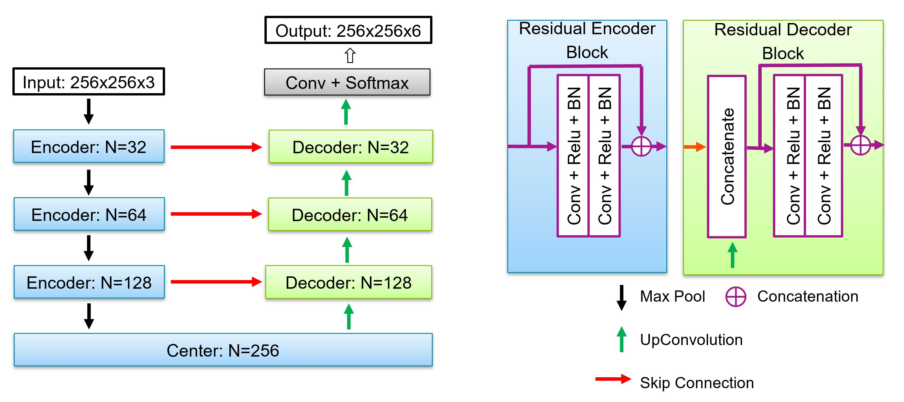</p>

Parameters: **16.5 M** with `filters=32`, **4.1 M** with `filters=16` (CPU: 6.4 s vs 1.9 s per batch of 8).

### Patch extraction
<p align="center">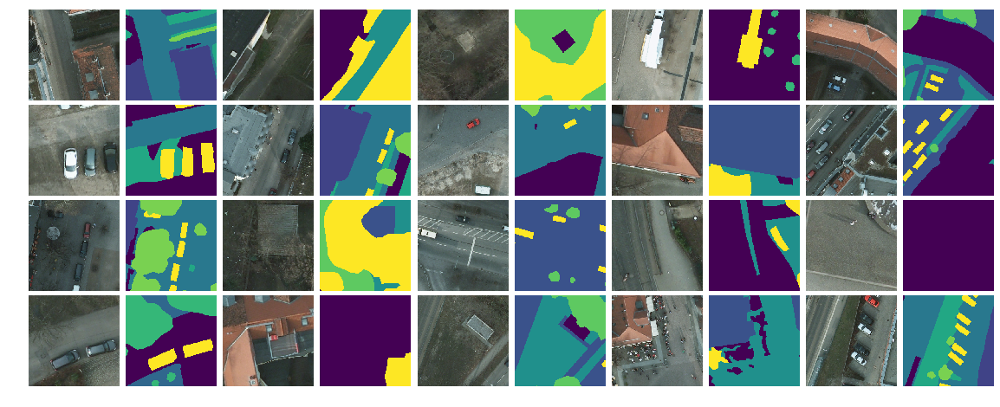</p>

---

## 📊 Results (re-measured, ISPRS Potsdam)

**Protocol.** Potsdam 5 cm RGB(+NIR) true orthophotos, official *eroded-boundary* labels (boundary pixels ignored).
Train tiles `2_10 3_11 4_12 5_10 6_8 6_11`, validation `7_9 7_12`, test = official test tiles `2_13 3_14 5_15`.
All methods scored on the same 12 fixed 1024×1024 test crops; mIoU / mF1 over 5 classes (clutter excluded, as in the
literature). CPU only (4 vCPU), so the deep model is **time-boxed**, not trained to convergence.

<!-- RESULTS_TABLE_START -->
| Method | mIoU (5 cls) | mF1 | OA |
|---|---|---|---|
| ⏳ Re-running with corrected label mapping — table is filled in by `report/make_assets.py` | | | |
<!-- RESULTS_TABLE_END -->

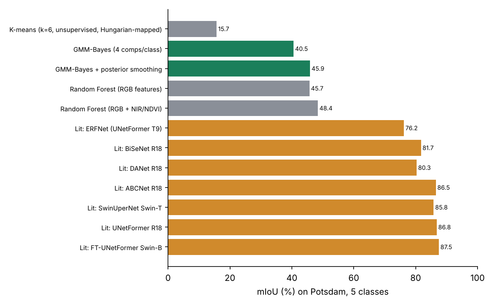
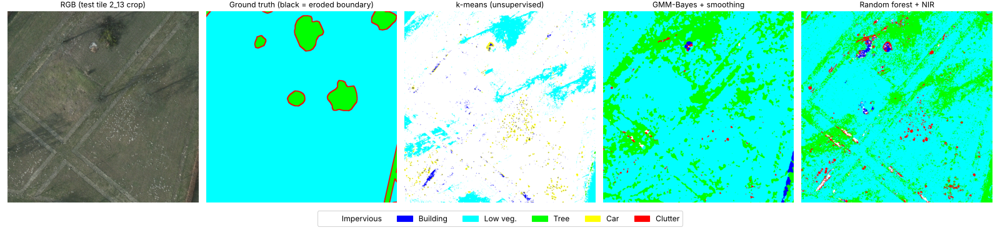

**Literature (full test set, GPU, 100 epochs)** — from UNetFormer (Wang et al., 2022):

| Method | Backbone | mF1 | mIoU |
|---|---|---|---|
| BiSeNet | ResNet-18 | 89.8 | 81.7 |
| U-Net + ResNet-18 (baseline) | ResNet-18 | – | 82.5 |
| ABCNet | ResNet-18 | 92.7 | 86.5 |
| UNetFormer | ResNet-18 | 92.8 | 86.8 |
| FT-UNetFormer | Swin-B | 93.3 | 87.5 |

### Original author's figures (from the first version of this repo; not reproduced by a script here)

| Without TTA | With TTA |
|---|---|
| 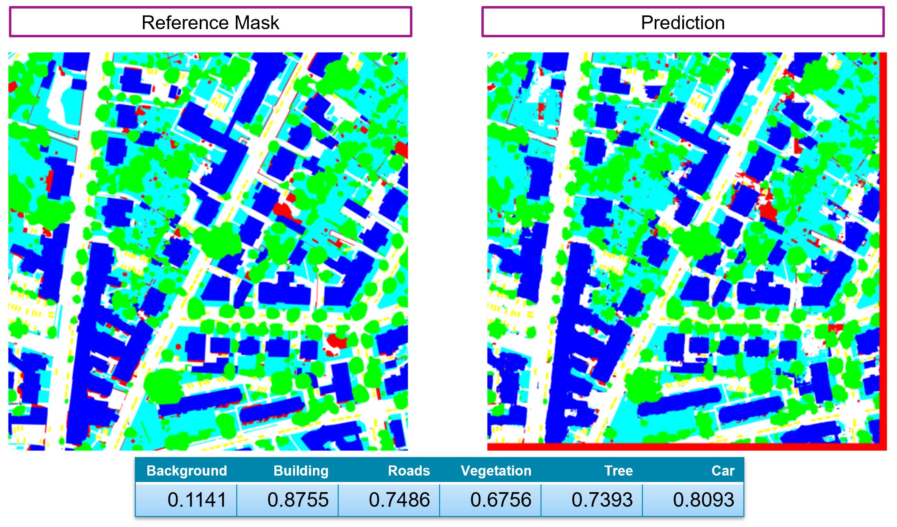 | 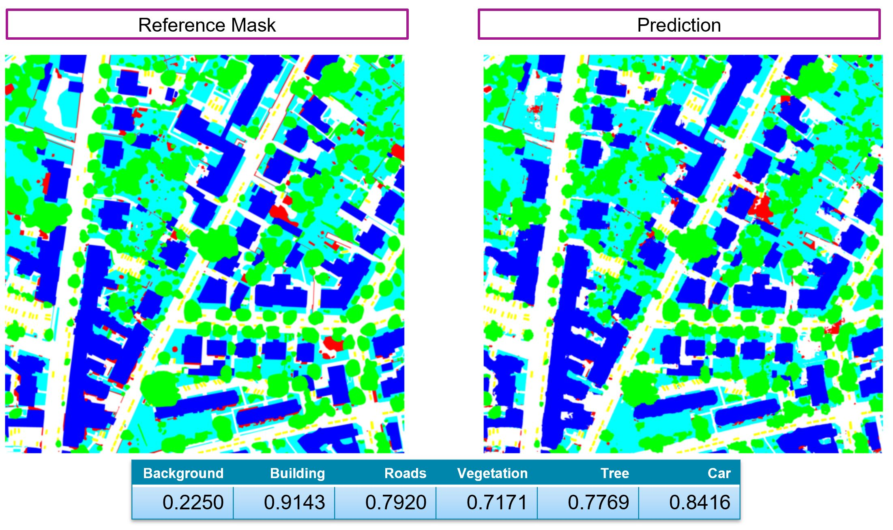 |

<p align="center">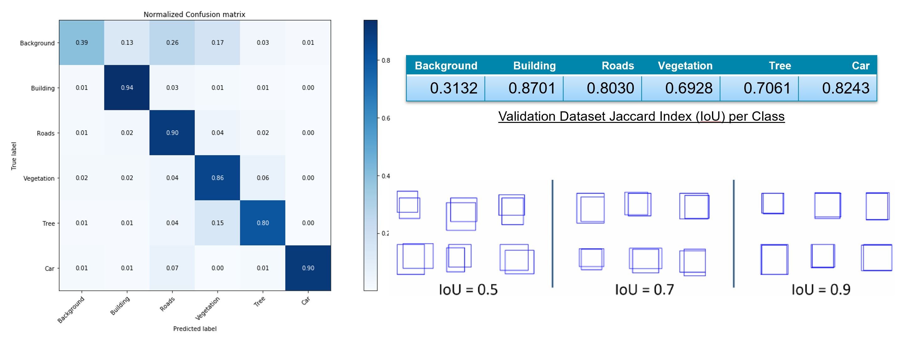<br><em>Confusion matrix & per-class IoU (original run)</em></p>
<p align="center">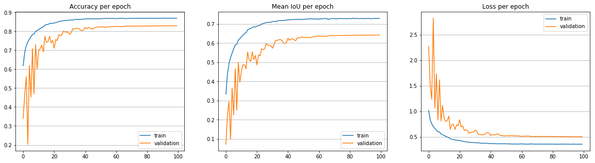<br><em>Training curves (original run)</em></p>
<p align="center">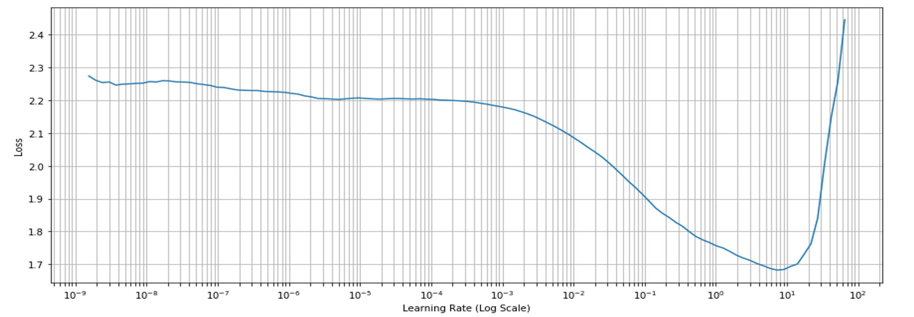 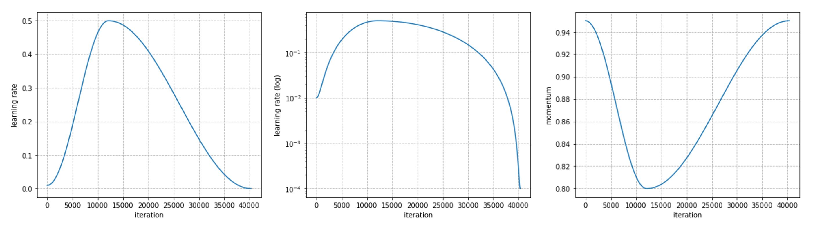<br><em>LR finder and one-cycle schedule</em></p>

> ⚠️ The first README listed per-class IoUs (building 0.85, car 0.82, …) that no script in the repo produces. The table
> above is what the code produces today; quote those numbers.

---

## 🐛 Fixes in this version

| Problem | Fix |
|---|---|
| `range(0, h-p+1, stride)` never reaches the border: on 6000-px tiles the last **112 rows/cols (3.7 % of pixels)** were never predicted and became class 0 | Border-aligned final patch in `src/inference/predictor.py` |
| YAML config is nested but predictor/TTA read flat keys → `num_classes` silently 5 for a 6-class model | Accept nested configs; default to `model.output_shape[-1]` |
| README claimed "loop-free `scatter_nd`" stitching; the code loops over patches | Documentation corrected |
| "Residual" blocks are concatenations, not additions | Documentation corrected |
| `src/utils` imports `seaborn` (missing from requirements) | Add `seaborn` to your environment |

---

## 📂 Project Structure
```
Satellite_based_tile_segmentation/
├── src/
│   ├── models/      blocks.py · unet.py · losses.py
│   ├── data/        patch_extraction.py · augmentation.py · dataset.py
│   ├── training/    lr_finder.py · one_cycle.py · metrics.py · trainer.py
│   ├── inference/   predictor.py (fixed) · tta.py (fixed)
│   └── utils/       mask_utils.py · visualization.py
├── benchmarks/      potsdam.py · exp_classical_seg.py · exp_unet.py · exp_yolo.py
├── configs/         isprs_config.yaml · inria_config.yaml
├── notebooks/       01_data_exploration.ipynb · 02_training.ipynb
├── images/          original figures
├── report/          technical report (PDF/MD), slides, figures
└── results/         raw JSON results
```

---

## ⚙️ Installation
```bash
python -m venv venv && source venv/bin/activate
pip install -r requirements.txt seaborn
pip install -e .
```

### Dataset
ISPRS Potsdam ([official page](https://www2.isprs.org/commissions/comm2/wg4/benchmark/2d-sem-label-potsdam/), or the
Hugging Face mirror `aamante/potsdam` used by `benchmarks/potsdam.py`). Label ids in that mirror:
`1 impervious, 2 building, 3 low vegetation, 4 tree, 5 car, 0 clutter, 6 eroded boundary (ignored)`.

---

## 🎮 Quick Start

### Training
```python
import yaml
from src.models.unet import get_unet_model
from src.data.dataset import get_dataset
from src.training.trainer import Trainer

config = yaml.safe_load(open('configs/isprs_config.yaml'))
model = get_unet_model(input_shape=tuple(config['model']['input_shape']), filters=config['model']['filters'],
                       n_block=config['model']['n_block'], n_class=config['dataset']['num_classes'],
                       mode=config['model']['bottleneck_mode'], residual=config['model']['residual'])
train_ds = get_dataset(img_dir=config['dataset']['train_img_dir'], mask_dir=config['dataset']['train_mask_dir'],
                       batch_size=config['training']['batch_size'], config=config)
Trainer(model, config).train(train_ds, val_ds)
```

### Inference
```python
from src.inference.predictor import get_tile_prediction
from src.inference.tta import get_tile_tta_pred
prediction = get_tile_prediction('path/to/tile.tif', model, config)       # nested config now OK
prediction_tta = get_tile_tta_pred('path/to/tile.tif', model, config)
```

### Reproduce the benchmark
```bash
python -m benchmarks.exp_classical_seg                      # k-means, GMM-Bayes, random forest (~15 min CPU)
python -m benchmarks.exp_unet --minutes 30 --filters 16     # this repo's U-Net, time-boxed CPU training
python -m benchmarks.exp_yolo --minutes 20                  # YOLOv8n-seg car instances
```

---

## 📚 Technical Deep-Dive

**Patch extraction.** `tf.image.extract_patches` extracts all 256×256 patches of a tile in one vectorised op
(529 patches per 6000×6000 tile at stride 256); multi-scale variants use dilation rates 1–3.

**Multi-scale context.** The bottleneck's dilated convolutions (rates 1, 2, 4, 8) enlarge the receptive field without
downsampling — critical for objects of very different size (buildings vs cars ↔ glands vs nuclei).

**Stitching.** Overlapping softmax maps are accumulated and divided by the coverage count, then `argmax`. With stride
< patch size this averages seams away; the last patch is aligned to the border.

**Training.** LR range test (Smith, 2015) → one-cycle policy (Smith, 2018); Jaccard loss for IoU, focal loss
(Lin et al., 2017) for imbalance (cars ≈ 1 % of pixels).

**Classical baselines** (for context): k-means colour clusters, a **GMM-Bayes classifier** (one Gaussian mixture per
class, Bayes rule with class priors), the same with posterior smoothing (a cheap MRF/CRF surrogate), and random forests
with/without NIR/NDVI. They show why shape and context (a deep receptive field) are needed for semantic segmentation.

---

## 🔗 Relevance to Medical Imaging & Digital Pathology

| Challenge | Aerial Imaging | Digital Pathology |
|-----------|---------------|-------------------|
| Image size | 6,000 × 6,000 px | 50,000 × 50,000+ px |
| Processing | Patch extraction → prediction → stitching | Identical pipeline |
| Classes | Buildings, roads, trees, cars | Tumour, stroma, necrosis, fluid, … |
| Class imbalance | Cars ≈ 1 % of pixels | Rare cells / small metastases |
| Colour shift | Season, sensor | Stain, scanner, lab |
| Augmentation | D4 rotations/flips, brightness | D4 + **H&E stain jitter** |

---

## 📖 References
- **U-Net**: Ronneberger et al., arXiv:1505.04597 · **ResNet**: He et al., arXiv:1512.03385 · **Focal loss**: Lin et al., arXiv:1708.02002
- **DeepLab / ASPP**: Chen et al., 2017–2018 · **UNetFormer**: Wang et al., arXiv:2109.08937
- **LR finder**: Smith, arXiv:1506.01186 · **One-cycle**: Smith, arXiv:1708.07120
